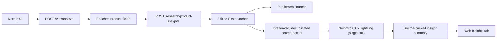

# Product Web Insights

This document describes the product web research feature for Catalog Enrichment.

The feature adds a backend research endpoint and a new frontend tab that summarize public web information about a product. It runs three fixed Exa searches and a single Nemotron 3.5 Lightning call to synthesize the report. The model never chooses or triggers searches, which keeps latency predictable (typically under 20 seconds).

## Goal

After product analysis, the UI should show a **Web Insights** tab next to the **FAQs** and **Protocols** tabs. The tab helps catalog managers understand what the web says about the identified product and brand:

- common pros and cons
- practical usage patterns
- differentiators and purchase considerations
- recurring customer questions or complaints
- source-backed insights that can inform later catalog copy, FAQs, imagery, and protocol exports

This feature is informational by default. It should not automatically rewrite the enriched title, description, FAQs, or protocol schemas without a later explicit product decision.

## User Flow

1. User uploads an image and optionally enters existing product data.
2. `/vlm/analyze` enriches the product title, description, categories, tags, and colors.
3. The frontend starts web insight generation in the background using the enriched product title as the primary input.
4. The backend runs three Exa searches: `<title>`, `<title> reviews`, and `<title> price`.
5. Results are interleaved so identity, review, and pricing evidence all reach the report, then deduplicated and capped at `max_sources`.
6. One Nemotron call classifies whether the evidence supports product-specific, brand-level, category-level, or insufficient-identity research and synthesizes a source-backed dashboard report.
7. The UI renders the result in the **Web Insights** tab after FAQ and protocol generation have had first access to the shared LLM service.

## Architecture



## Backend Contract

### Endpoint

`POST /research/product-insights`

Content-Type: `multipart/form-data`

| Parameter | Type | Required | Description |
|-----------|------|----------|-------------|
| `title` | string | Yes | Enriched product title. Used as the primary product and brand disambiguation input. |
| `description` | string | No | Enriched product description. Used only to reduce ambiguity, not as a source of web claims. |
| `categories` | JSON string | No | Categories array from `/vlm/analyze`. |
| `tags` | JSON string | No | Tags array from `/vlm/analyze`. |
| `locale` | string | No | Regional locale code for summary language and source preference (default: `en-US`). |
| `max_results` | integer | No | Maximum Exa results the search tool should return per query (default: 8, max: 20). |

### Response Schema

```json
{
  "summary": "string",
  "pros": ["string"],
  "cons": ["string"],
  "use_cases": ["string"],
  "customer_insights": ["string"],
  "purchase_considerations": ["string"],
  "search_queries": ["string"],
  "sources": [
    {
      "title": "string",
      "url": "string",
      "published_date": "string|null",
      "snippet": "string"
    }
  ],
  "warnings": ["string"],
  "locale": "en-US",
  "research_scope": "product_specific|brand_level|category_level|insufficient_identity",
  "identity_confidence": "high|medium|low|none",
  "detected_brand": "string|null",
  "detected_model": "string|null",
  "scope_note": "string",
  "identity_evidence": ["string"],
  "report": {
    "executive_summary": "string",
    "positioning_tags": ["string"],
    "metrics": {
      "customer_sentiment": {
        "label": "Positive|Mixed|Neutral|Negative|Not enough data",
        "score": "number|null",
        "scale": "percent",
        "rationale": "string"
      },
      "build_quality": {
        "label": "string",
        "score": "number|null",
        "scale": "label",
        "rationale": "string"
      },
      "price_segment": {
        "label": "string",
        "score": null,
        "scale": "label",
        "rationale": "string"
      },
      "retail_confidence": {
        "label": "string",
        "score": "number|null",
        "scale": "rating_10",
        "rationale": "string"
      }
    },
    "retail_insights": [
      {
        "type": "positive|negative",
        "title": "string",
        "detail": "string"
      }
    ],
    "primary_use_cases": [
      {
        "title": "string",
        "detail": "string"
      }
    ],
    "customer_sentiment_summary": "string"
  }
}
```

The flat fields remain for compatibility. The UI prefers the richer `report` object when present and falls back to flat fields for older responses. The identity fields explain the research scope. Brand/model detection is not a deterministic title-token heuristic; it must be supported by returned source evidence. For generic or unbranded titles, or when the sources do not confirm a brand/model, the endpoint returns `category_level` or `insufficient_identity`, clears `detected_brand`/`detected_model`, and suppresses product-specific numeric scores. The response must be source-aware. Any user-visible claim about market perception, reviews, complaints, comparisons, usage, or scores should be traceable to at least one returned source.

### Example

```bash
curl -X POST \
  -F "title=JBL Flip 6 Portable Bluetooth Speaker" \
  -F "description=A compact waterproof Bluetooth speaker with bold sound." \
  -F 'categories=["electronics"]' \
  -F 'tags=["bluetooth","speaker","portable","waterproof"]' \
  -F "locale=en-US" \
  http://localhost:8000/research/product-insights
```

## Research Pipeline

`build_product_web_insights` in `src/backend/web_insights.py`:

1. Runs three Exa searches in order: `<title>`, `<title> reviews`, `<title> price`, each returning up to `max_results` results with highlights.
2. Interleaves the result lists so identity, review, and pricing evidence all survive the `max_sources` cap, and deduplicates by URL.
3. Sends the source packet to Nemotron 3.5 Lightning in a single call (thinking disabled) with a focused system prompt that allows only claims supported by the supplied sources.
4. Repairs and validates the structured output, then normalizes dashboard metrics: numeric scores are clamped, and neutral values are returned when source coverage is weak.

Query selection is deterministic; the model never requests additional searches. Do not hardcode product-specific examples in the prompt and do not infer brand identity from token position. When the sources do not confirm a reliable brand or model, the model must not guess one and should report brand-level, category-level, or insufficient-identity scope instead.

Exa returns concise highlights rather than full page text for latency and token control. Exa does not generate source summaries; Nemotron owns all summarization, scoring, and dashboard synthesis.

## Configuration

Required environment variables for the full Web Insights flow:

```bash
NGC_API_KEY=...
EXA_API_KEY=...
```

If `EXA_API_KEY` is not configured, `/research/product-insights` returns a non-error disabled payload. The UI should show a configuration message in the Web Insights tab and the rest of the enrichment flow should continue.

The Nemotron endpoint and model should come from the existing `llm` section in `shared/config/config.yaml` unless a later implementation needs a separate `research_llm` section.

Proposed optional config:

```yaml
web_insights:
  max_results: 8
  max_sources: 8
  min_sources: 2
  search_type: "auto"
  highlights_max_characters: 4000
```

## UI Behavior

The `FieldsCard` tab set should become:

- Details
- FAQs
- Web Insights
- Protocols

The **Web Insights** tab should include:

- loading state: `Researching product insights...`
- empty state when no research has run
- unavailable state when `EXA_API_KEY` is not configured
- a compact scope note for brand-level, category-level, or insufficient-identity research
- compact metric blocks for customer sentiment, build quality, price segment, and retail confidence
- executive summary with positioning tags
- grouped positive and negative retail insight cards
- primary use case cards
- customer sentiment narrative
- no repeated product image, raw warning list, or visible source list in the report view

Failures should not block FAQ generation, protocol schema generation, image variation generation, or 3D generation. Web Insights should not mutate the title, description, FAQs, protocols, images, or 3D outputs.

## Guardrails

- Treat public web data as external, unverified context, not product truth.
- Prefer official manufacturer, retailer, review, and support pages when available.
- Do not guess a brand or model from title position. Use source evidence for identity classification and category-level insights when sources do not identify a specific product.
- Include source URLs for claims that could affect merchandising or product positioning.
- Keep source snippets short and do not reproduce long copyrighted text.
- Exclude unsafe, irrelevant, duplicate, or spam-like sources.
- Do not use web claims to override visual evidence from the product image unless a later implementation explicitly adds a human review workflow.
- Do not include personally identifying information from individual commenters or reviewers.
- Respect Exa rate limits and platform terms.

## External References

- Exa Python SDK: <https://exa.ai/docs/sdks/python-sdk>
- Exa Search API: <https://exa.ai/docs/reference/search>
